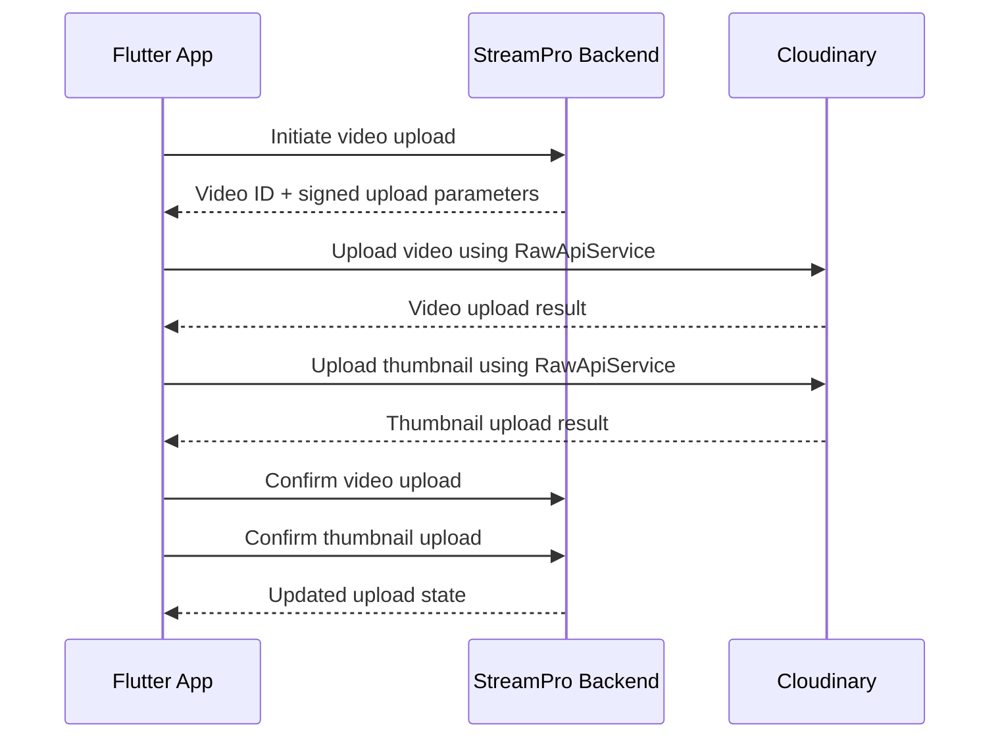
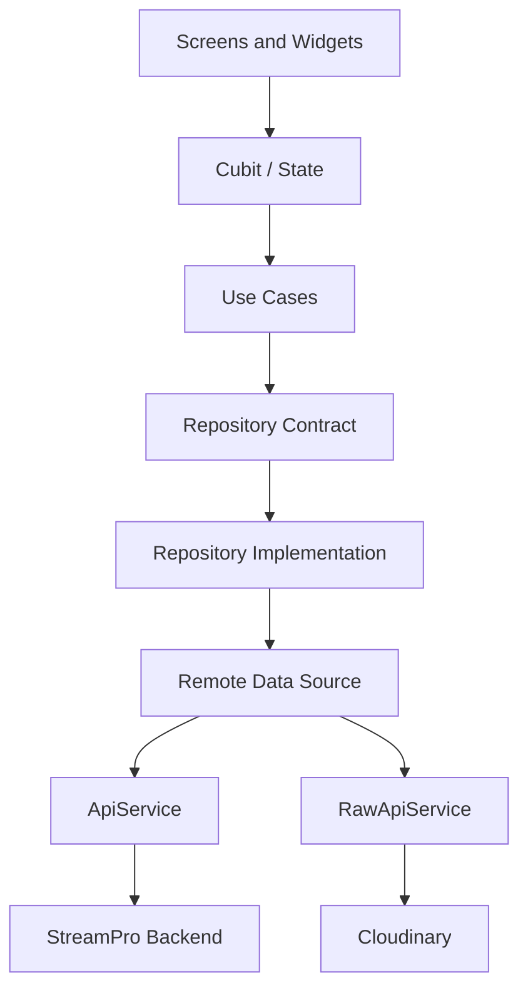

<div align="center">
  
  <h1>StreamPro</h1>
  <p><strong>A mobile video platform built around thoughtful product and engineering decisions.</strong></p>
  <p>Video discovery · Playback · Creator workflows · Community · Account management</p>
  <p>
    <a href="https://github.com/WaelLasheen/stream-pro/actions/workflows/main.yml"></a>
    
    
    <a href="LICENSE"></a>
  </p>
</div>

---

## Overview

**StreamPro** is a collaborative mobile video platform developed with Flutter. It brings together the experiences of watching, discovering, organizing, and publishing video content in one application.

The product direction was shaped through hands-on observation of established video platforms: studying interaction patterns, navigation behavior, creator workflows, and the details that make a video experience feel coherent. Those observations informed the product decisions, while the mobile flows, architecture, state handling, API boundaries, and delivery pipeline were designed and implemented as part of this project.

This repository contains the **Flutter mobile client**. The project was built collaboratively: the mobile application was developed by **Wael Lasheen**, while a teammate worked on the web client and backend.

> The focus of this project is not only the screens users see. A considerable part of the work went into the engineering behind them: state transitions, pagination behavior, session cleanup, navigation history, authenticated networking, and a separated media-upload flow.

## Product capabilities

### Viewing and discovery

- Browse a video feed with paginated loading.
- Search videos, explore suggestions, and filter by categories.
- Watch videos with integrated playback controls and related-video content.
- View channel pages, channel videos, and channel playlists.
- Like videos, subscribe to channels, and manage saved content.
- Read comments, participate in threaded replies, and manage personal interactions.
- Keep track of watch history, liked videos, and Watch Later content through a consolidated library.
- Download videos to the device.
- Share a video link that opens the corresponding web experience.

### Creator workflows

- Manage the owner channel and its content.
- Upload videos with metadata and a dedicated thumbnail.
- Edit video details, update thumbnails, change publishing status, and delete content.
- Create, edit, delete, and reorder playlists.
- Add or remove videos from playlists.
- View channel subscribers and manage creator-side content.

### Accounts and personalization

- Register and sign in using email and password.
- Sign in with Google; the mobile client obtains a Google ID token and exchanges it with the project backend.
- View active account sessions, revoke an individual session, or request logout from all sessions.
- Receive push notifications through Firebase Cloud Messaging and view application notifications fetched from the backend.
- Use the interface in **Arabic or English**.
- Choose from **five themes**: Light, Dark, Modern, Green, and Red.

## Engineering highlights

The following sections describe implementation decisions that are particularly important to how StreamPro behaves.

<details>
<summary><strong>1. Feature-first Clean Architecture</strong></summary>

The codebase is organized by feature, with presentation, domain, and data responsibilities separated inside the feature modules.

A typical feature follows this direction:

```text
feature/
└── some_feature/
    ├── data/
    │   ├── datasources/
    │   ├── models/
    │   └── repositories/
    ├── domain/
    │   ├── entities/
    │   ├── repositories/
    │   └── use_cases/
    └── presentation/
        ├── controllers/
        ├── screens/
        └── widgets/
```

Repository contracts live in the domain layer, while their implementations and remote data sources live in the data layer. Use cases provide feature-level operations to Cubits. Dependencies are assembled through `GetIt`, with feature registration split into DI modules.

This structure keeps UI code away from transport details and makes individual features easier to reason about and test.

</details>

<details>
<summary><strong>2. State management is chosen per feature</strong></summary>

StreamPro intentionally uses more than one state-modeling style. The choice depends on the shape of the feature rather than forcing every screen into one pattern.

- **Sealed state hierarchies** are used when the UI moves between distinct modes, such as initial, loading, loaded, empty, and failure. Examples include the home feed, comments, notifications, and video details.
- **A single immutable state object with `copyWith`** is used when several independent values coexist and can change without representing mutually exclusive screen modes. The application configuration state, for example, keeps the selected locale and theme together.
- Some features use a hybrid: a shared state base carries existing data, while concrete state types represent the current operation or outcome. This helps preserve content when an operation fails.

The goal is to make state transitions explicit while keeping the state shape appropriate to the feature.

</details>

<details>
<summary><strong>3. Centralized error handling and typed failures</strong></summary>

The data layer uses `Either<Failure, T>` to return expected operation results. The shared `safeCall` helper wraps asynchronous operations and maps known exceptions into feature-facing failures, with an unknown-failure fallback.

This reduces repeated `try/catch` and exception-to-failure mapping across repositories. The project also defines application-specific exception and failure types for cases such as server, cache, gallery, and Google authentication errors.

The UI is designed around explicit loading, empty, and error states. Shimmer placeholders are used while content is loading, while empty and failure states have dedicated views.

For paginated lists, some features preserve previously loaded content when a later page fails. Comments and notifications, for example, can keep the current items visible and expose a retry action for the next page instead of replacing the whole screen with an initial-load error.

</details>

<details>
<summary><strong>4. Two deliberately separate HTTP clients</strong></summary>

The application uses two different HTTP service abstractions for two different trust boundaries.

| Client          | Responsibility                                                                              |
| --------------- | ------------------------------------------------------------------------------------------- |
| `ApiService`    | Communicates with the StreamPro backend.                                                    |
| `RawApiService` | Sends requests to external media services without reusing the authenticated backend client. |

The main `ApiService` is configured with the backend base URL and the application's networking behavior, including:

- Bearer access-token attachment.
- Cookie persistence and cleanup.
- A refresh interceptor that retries requests after an authentication failure.
- Debug-only request and response logging.

`RawApiService` uses a separate `Dio` instance. It is not configured with the backend base URL, application access-token interceptor, refresh interceptor, or backend cookie manager.

This separation is used in the Cloudinary upload flow: the backend issues the upload signature and parameters, and the mobile client sends the media request directly to Cloudinary through the raw client. The external upload request does not need the application's backend access token or backend cookies.

</details>

<details>
<summary><strong>5. Signed media-upload workflow</strong></summary>

The current upload flow is coordinated between the mobile client, the backend, and Cloudinary:



The backend remains responsible for issuing the signed parameters and receiving the completion details. The mobile client handles the media transfer without attaching its authenticated backend session to the Cloudinary request.

**Current limitation:** the video is uploaded as one file in a single upload operation. Resumable/chunked transfer is planned and is not yet implemented.

</details>

<details>
<summary><strong>6. Navigation history and context-aware routing</strong></summary>

Navigation behavior is handled with a route observer and a route-history observer.

One concrete case is channel navigation. Before opening a channel, the navigation extension checks whether that same channel is already present in the active route history. If it is, the app pops back to the existing route instead of pushing another copy. If it is not, the channel route is pushed normally.

This avoids unnecessary duplicate channel pages while preserving the useful navigation history underneath the target route.

Application notifications also use their payload type to select an appropriate destination:

- A **like** opens the related video.
- A **comment or reply** opens that video with the comments tab selected.
- A **subscription** opens the owner-channel area at the relevant tab.
- A **playlist** opens the playlist details screen.

Both in-app notification taps and external FCM/system-notification taps use this payload-aware routing. If the payload does not contain enough information to resolve a destination, the app opens the in-app notifications screen instead.

</details>

<details>
<summary><strong>7. Session-aware cache management</strong></summary>

Some server-backed values are cached in memory to avoid asking the backend for the same information repeatedly.

For example, the Watch Later repository maintains a `Map<String, bool>` keyed by video ID. Once the app knows whether a video is in Watch Later, later checks can use the cached value. When the value is not known, the repository asks the backend and stores the result. Successful add/remove operations update the cached value.

The repository registers itself with `SessionCacheRegistry`. During session cleanup, registered caches are cleared so one account's cached state is not reused after another account signs in.

The session cleanup service also coordinates cookie cleanup, secure and local storage cleanup, notification cancellation, Firebase/Google sign-out, and Flutter image-cache cleanup. The user's selected locale and theme are preserved across this cleanup.

</details>

<details>
<summary><strong>8. Optimistic interactions</strong></summary>

Several interactions update the UI before the remote operation finishes, then reconcile the result.

Examples include playlist updates such as adding/removing a video, reordering playlist items, and editing playlist details. Comment and profile operations also use optimistic updates in selected flows.

Where the remote operation fails, the relevant feature can restore the previously held data and expose the failure. This keeps common interactions responsive without silently treating a failed server operation as successful.

</details>

## Architecture at a glance



## Technology stack

| Area                      | Technologies                                                     |
| ------------------------- | ---------------------------------------------------------------- |
| Mobile                    | Flutter, Dart                                                    |
| State management          | Bloc, Cubit, Equatable                                           |
| Architecture and DI       | Clean Architecture, Repository Pattern, GetIt                    |
| Networking                | Dio, interceptors, cookie manager                                |
| Functional error handling | Dartz `Either`                                                   |
| Authentication            | Backend email/password authentication, Google Sign-In            |
| Firebase services         | Firebase Core, Cloud Messaging, Crashlytics                      |
| Video                     | `video_player`, Chewie                                           |
| UI and localization       | Material 3, ScreenUtil, Shimmer, Flutter Localizations, `intl`   |
| Local persistence         | Shared Preferences, Flutter Secure Storage, cookie storage       |
| Device integrations       | Share Plus, file picker, gallery integration, device information |
| Automation                | GitHub Actions, Firebase App Distribution, Telegram delivery     |

## Project structure

```text
lib/
├── core/
│   ├── app_config/
│   ├── di/
│   ├── error/
│   ├── networking/
│   ├── notifications/
│   ├── routing/
│   ├── services/
│   ├── shared/
│   ├── theme/
│   └── utils/
├── feature/
│   ├── Likes/
│   ├── auth/
│   ├── category/
│   ├── channel/
│   ├── comments/
│   ├── home/
│   ├── library/
│   ├── notifications/
│   ├── owner_channel/
│   ├── playlist/
│   ├── profile/
│   ├── search/
│   ├── sessions/
│   ├── subscriptions/
│   ├── video_details/
│   ├── video_management/
│   ├── watch_history/
│   └── watch_later/
├── generated/
└── l10n/
```

Each feature owns its models, domain entities, repository contract, use cases, presentation state, and UI components where applicable. Shared infrastructure and reusable widgets live under `core`.

## Getting started

### Requirements

- Flutter **3.32.7** (the version currently used by the CI workflow).
- Android development toolchain configured through Flutter.
- Access to a compatible StreamPro backend.
- Firebase and Google OAuth configuration when using the corresponding integrations.

### Run locally

1. Clone the repository:

   ```bash
   git clone https://github.com/WaelLasheen/stream-pro.git
   cd stream-pro
   ```

2. Install dependencies:

   ```bash
   flutter pub get
   ```

3. Check the backend endpoint in `lib/core/networking/api_constants.dart` and make sure it points to the backend you intend to use.

4. Configure Firebase for your own application when needed. The project uses `firebase_options.dart` and the Android Firebase configuration for its Firebase integrations.

5. Supply the Google server client ID when running with Google Sign-In:

   ```bash
   flutter run --dart-define=GOOGLE_SERVER_CLIENT_ID=YOUR_SERVER_CLIENT_ID
   ```

6. Run the app:

   ```bash
   flutter run
   ```

### Build an Android release

```bash
flutter build apk --release --split-per-abi
```

The current CI workflow builds Android release APKs. An iOS build is not currently part of that workflow.

## CI/CD

The GitHub Actions workflow runs on pushes and pull requests targeting `main` or `master`.

Its current pipeline:

1. Checks out the repository and configures Java and Flutter.
2. Installs Flutter dependencies.
3. Runs `flutter analyze`.
4. Runs `flutter test`.
5. Builds release APKs split by ABI.
6. Uploads the ARM64 APK as a GitHub Actions artifact.
7. Distributes the APK through Firebase App Distribution.
8. Sends the APK to the configured Telegram chat.

Secrets for Firebase and Telegram are configured through GitHub Actions repository secrets.

[View the GitHub Actions workflow](.github/workflows/main.yml).

## Testing

Run the current automated test suite with:

```bash
flutter test
```

The existing tests cover selected playlist models and Cubit behavior, owner-playlist behavior, and profile/account actions. The project has a broader feature surface than the current test suite, so expanding coverage for networking, authentication refresh, pagination, session cleanup, notification routing, and upload failure scenarios is an important next step.

## Roadmap

The following items are planned improvements; they should not be read as already shipped functionality.

- [x] **Payload-aware push navigation:** open the exact video, comment, reply, playlist, or channel associated with an external FCM/system notification.
- [ ] **App Links and deep links:** open shared video URLs directly in StreamPro when the app is installed, while retaining a web fallback.
- [ ] **Canonical URL alignment:** define a consistent URL strategy between the mobile app, web client, and backend.
- [ ] **Resumable chunked uploads:** split large video uploads into chunks, track acknowledged progress, retry failed chunks, and resume an interrupted upload instead of restarting the entire file.
- [ ] **Consistent pagination recovery:** standardize retained-content errors and retry controls across every paginated feature, including the home feed.
- [ ] **Playback-position continuity:** resume a video from its last known position across all relevant entry points, not only the watch-history flow.
- [ ] **Broader automated coverage:** add tests for API interceptors, token-refresh concurrency, repository caching, notification routing, and upload failures.

## Collaboration and ownership

StreamPro was developed collaboratively. This repository focuses on the Flutter mobile application; the web client and backend are maintained separately as part of the same project.

For questions about the mobile implementation, you can reach **Wael Lasheen** through [GitHub](https://github.com/WaelLasheen).

## License

This project is licensed under the [MIT License](LICENSE).
